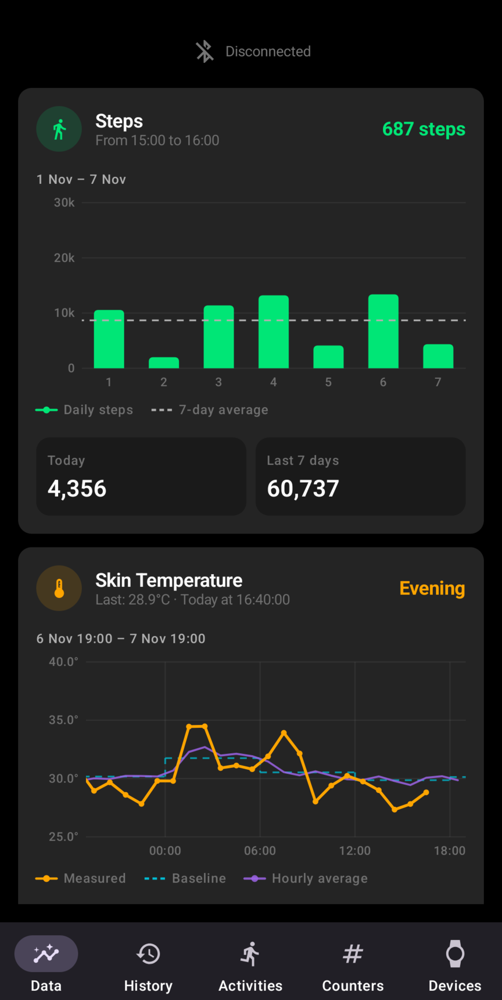
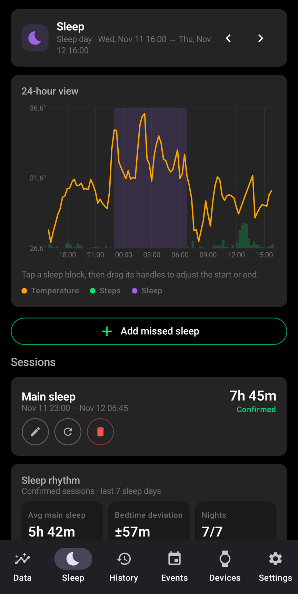
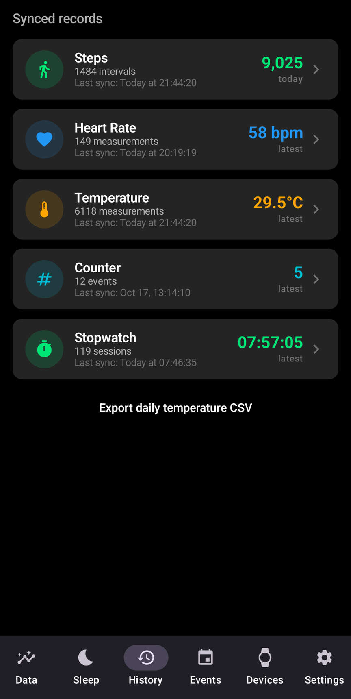
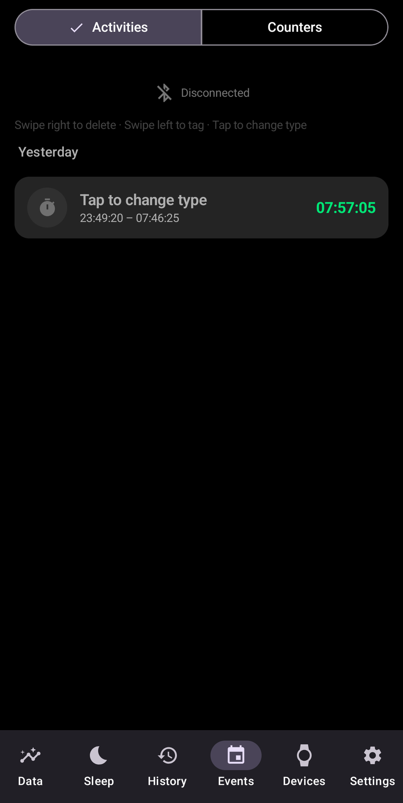
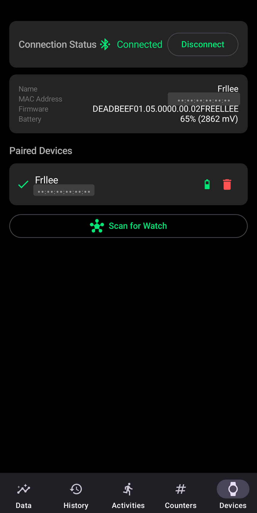
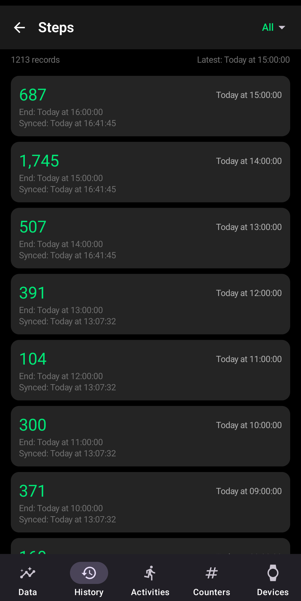
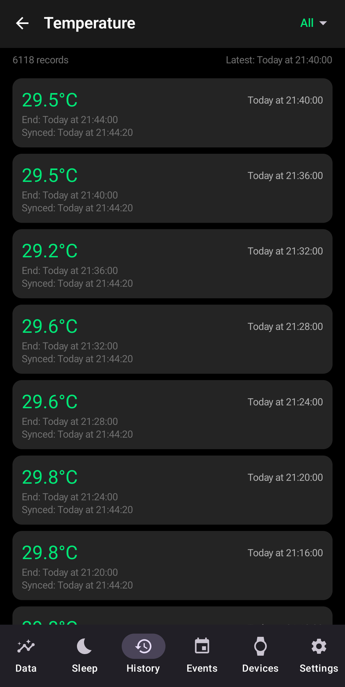

# Freellee

An **unofficial** Android app for [Ollee Watch](https://ollee.com) boards. No internet required — everything runs locally on your phone.

<div align="center">

<a href="https://apps.obtainium.imranr.dev/redirect?r=obtainium://add/https://github.com/hsanjuan/freellee"></a>

</div>

## Features

- **Bluetooth LE pairing** with Ollee watches (board-level firmware)
- **Syncs Steps, Heart Rate, Skin Temperature, Sleep, and Exercise Sessions** to [Android Health Connect](https://developer.android.com/health-and-fitness/health-connect)
- **Automatic sleep detection** with main/nap classification, drag-to-adjust corrections, and confirmed-only Health Connect export
- **Battery history** for paired watches, with a compact 60-day trend in the Devices tab
- **Stopwatch events** synced as Exercise Sessions or Sleep Sessions to Health Connect
- **Compatible with official firmware** — works out of the box
- Additional tooling in repository:
  - **YAML config export/import** — read and write full watch configurations
  - **Firmware flashing** — flash custom images


## Screenshots

| Data | Sleep | History |
|---|---|---|
|  |  |  |

| Events | Devices | Settings |
|---|---|---|
|  |  |  |

| Record details |
|---|
|  |

## Requirements

- An Ollee Watch board
- Android 14 (API 34) or higher
- Bluetooth LE capable device

## Skin Temperature

Unlike the official app, Freellee logs temperature readings as **SkinTemperature** records (not BodyTemperature) in Health Connect. Skin temperature can help track general health and signal illness early via deviation from your personal baseline.

## Sleep and custom firmware

Automatic sleep detection is only reliable with custom firmware that performs skin temperature readings frequently (every 4 minutes) and records step intervals every 15 minutes; stock firmware's hourly data is too coarse for accurate sleep boundaries. The firmware image is not provided with this project, but the utilities in [`tools/`](tools/), such as `flash_ollee.py`, can be used to flash custom images.

## Stopwatch Events

Stopwatch events from the watch appear under **Events → Activities**. Before syncing events to Health Connect, you can choose an **exercise type** (running, HIIT, football, etc.) or mark it as **Sleep**. This lets Health Connect accurately categorize and display your workouts or sleep sessions. These manual tags are separate from the automatic Sleep tab detection; the app does not infer sleep from stopwatch records.

Counter events live under **Events → Counters**, where each event can be given a meaning before it is written to Health Connect.

## Build & Install

```bash
# Debug build
./gradlew assembleDebug

# Install on connected device
./gradlew installDebug
```

Or manually:

```bash
adb install app/build/outputs/apk/debug/app-debug.apk
```

## License

This project is licensed under the [GNU General Public License v3.0 or later](LICENSE).
