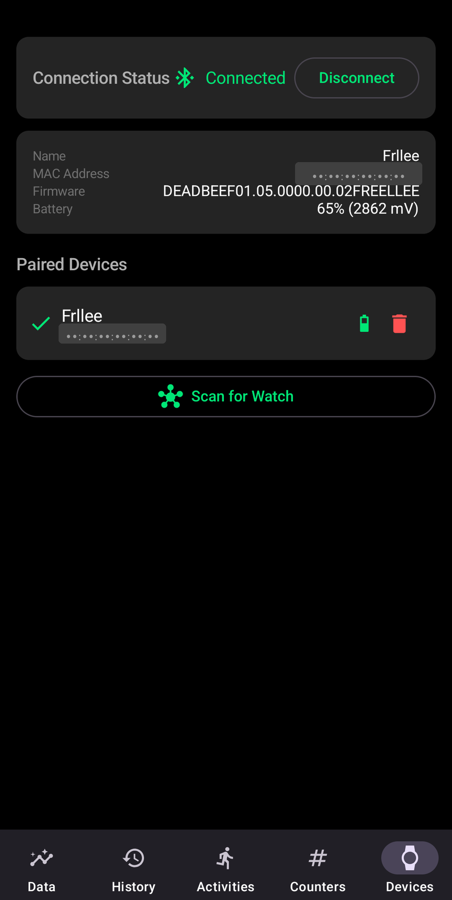
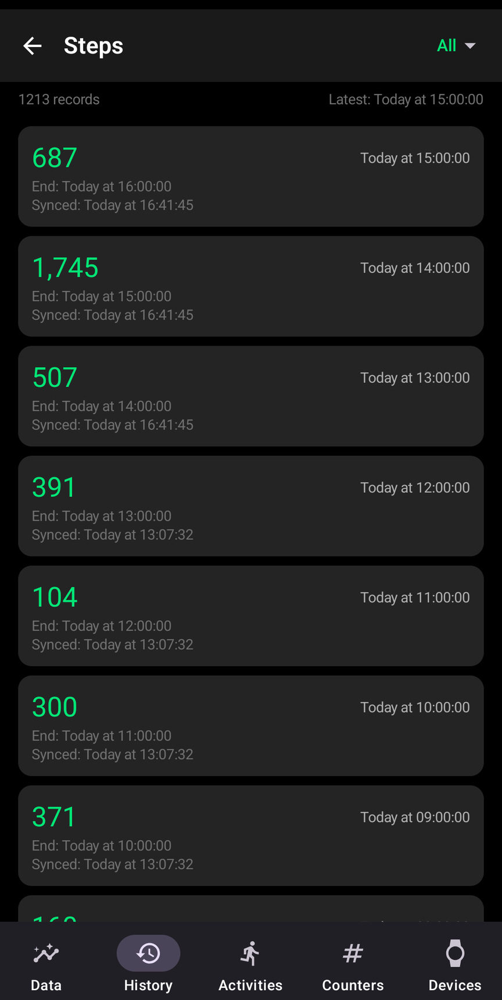
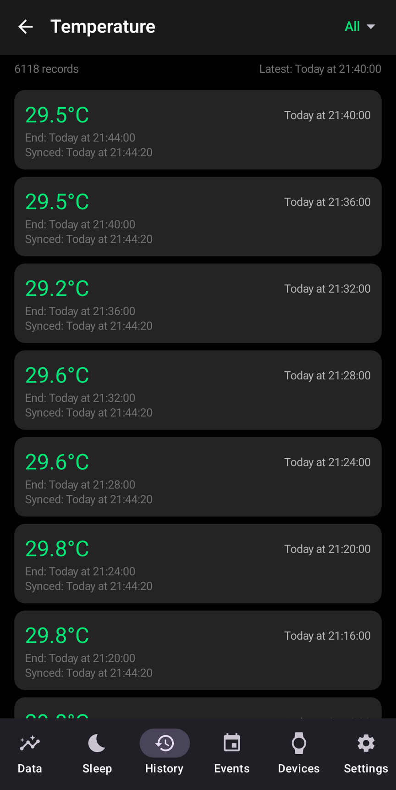

# Freellee

An **unofficial** Android app for [Ollee Watch](https://ollee.com) boards. No internet required — everything runs locally on your phone.

<div align="center">

<a href="https://apps.obtainium.imranr.dev/redirect?r=obtainium://add/https://github.com/hsanjuan/freellee"></a>

</div>

## Features

- **Bluetooth LE pairing** with Ollee watches (board-level firmware)
- **Syncs Steps, Heart Rate, Skin Temperature, Sleep, and Exercise Sessions** to [Android Health Connect](https://developer.android.com/health-and-fitness/health-connect)
- **Automatic sleep detection** with main/nap classification, drag-to-adjust corrections, and confirmed-only Health Connect export
- **Stopwatch events** synced as Exercise Sessions or Sleep Sessions to Health Connect
- **Compatible with official firmware** — works out of the box
- Additional tooling in repository:
  - **YAML config export/import** — read and write full watch configurations
  - **Firmware flashing** — flash custom images


## Screenshots

| Data | Sleep | History |
|---|---|---|
|  |  |  |

| Events | Devices | Settings |
|---|---|---|
|  |  |  |

| Record details |
|---|
|  |

## Requirements

- Android 14 (API 34) or higher
- Bluetooth LE capable device

## Skin Temperature

Unlike the official app, Freellee logs temperature readings as **SkinTemperature** records (not BodyTemperature) in Health Connect. Skin temperature can help track general health and signal illness early via deviation from your personal baseline.

Freellee keeps the raw 4-minute samples for 28 days and stores compact daily aggregates for much longer. The dashboard compares today's four day parts — **night, morning, afternoon, evening** — with a **personal 24-hour reference profile** built from the previous 28 days, and shows each part's deviation plus the share of expected readings that were actually valid. The Sleep card averages the last three reliable main sleeps so a single noisy night is not over-interpreted.

Gaps with no valid readings are shaded on the chart as **no readings** (which can mean the watch was off the wrist, outdoors, or the reading was rejected), with the threshold scaled to the watch's sampling interval (so normal hourly gaps are not flagged). Time since the last successful sync is marked **unsynced** instead: those readings have not arrived yet, so they are excluded from the valid-reading percentage.

Health Connect receives one record per day part. Its baseline is frozen when that day is first aggregated, the interval spans the actual first and last valid reading, and every valid reading contributes one delta.

The **History** tab can export the stored daily aggregates (hourly medians, coverage and frozen baselines) as a CSV file.

> **Tip:** It is recommended to patch the watch firmware to perform SkinTemperature readings more often than once an hour for best results.

## Firmware and advanced features

Stock Ollee firmware reports both steps and skin temperature once per hour. That is enough for temperature tracking, daily baselines and Health Connect, but it is far too coarse for sleep boundaries.

The **Settings** tab shows the sampling interval the watch is actually reporting for steps and temperature. Advanced features expect a patched firmware that logs **steps every 15 minutes** and **skin temperature every 4 minutes**, and are enabled automatically once the watch reports steps that often.

You can override the automatic decision with the **Advanced features** switch. Turning it on with stock firmware shows a warning explaining that a patched firmware is required and that sleep times will be off by up to an hour. Setting the switch off always falls back to basic skin-temperature tracking plus Health Connect. When advanced features are off, the **Sleep** tab is hidden and sleep detection does not run.

## Sleep

The **Sleep** tab detects sleep sessions across the whole day, not just at night. It combines zero-step periods with the temperature signature of sleep: a sustained rise during the session and a fall afterwards. This catches the main night sleep and shorter naps, including morning naps after an early wake-up.

Each sleep day runs from **16:00 to 16:00**, so a night and the following morning nap belong together. Detected sessions are marked **Main sleep** or **Nap**, with a confidence score.

Sessions can be corrected several ways:

- **Confirm** a session ("Looks right") to make it authoritative.
- **Adjust** the start/end with the time dialog, or select the block in the 24-hour view and **drag its handles**, snapping to 15 minutes.
- **Merge with next session** when an awakening split one night into two.
- **Add missed sleep**, prefilled from the previous main sleep.
- **Remove** a false positive; a short snackbar offers **Undo**.

Corrections are kept as the authoritative version and suppress the overlapping detection. Brief awakenings are also rejoined automatically when the gap is short and quiet. A session that is still running is marked **In progress** and cannot be confirmed until it closes.

Only **confirmed** sessions are written to Health Connect as `SleepSessionRecord`s; detections stay local until you confirm them. Each session keeps a stable Health Connect id, so adjusting or re-confirming it updates the existing record instead of adding a duplicate, and removing or resetting a session deletes it.

The Data tab has a separate **Sleep** card with three summaries — average confirmed sleep per day over the last 7 days, total confirmed sleep in the last 24 hours, and the sleep temperature deviation vs usual — plus every confirmed session from the last 48 hours (main sleep and naps). The Sleep tab's rhythm card uses confirmed sessions only: average main-sleep duration, bedtime spread and nights confirmed per week.

Detection resolution follows the step interval the watch reports. With stock hourly buckets the sessions would only be accurate to about an hour, so the tab requires a patched firmware (15-minute buckets are ideal). See [Firmware and advanced features](#firmware-and-advanced-features).

Because zero steps can mean "lying still awake" as much as "asleep", a long quiet run is trimmed to the first clear **skin-temperature onset**: a sustained rise above the pre-sleep baseline. A late end is trimmed the same way: a sustained temperature fall, corroborated by the first small movements, marks waking even when there are not yet enough steps to end the run. Ambiguous nights keep the step-based boundaries rather than guessing.

Two ways to undo corrections: **Reset to detected** on a single session, or **Settings → Sleep data → Reset all sleep corrections**, which re-derives the last 28 days from raw data.

## Stopwatch Events

Stopwatch events from the watch appear under **Events → Activities**. Before syncing events to Health Connect, you can choose an **exercise type** (running, HIIT, football, etc.) or mark it as **Sleep**. This lets Health Connect accurately categorize and display your workouts or sleep sessions. These manual tags are separate from the automatic Sleep tab detection; the app does not infer sleep from stopwatch records.

Counter events live under **Events → Counters**, where each event can be given a meaning before it is written to Health Connect.

## Build & Install

```bash
# Debug build
./gradlew assembleDebug

# Install on connected device
./gradlew installDebug
```

Or manually:

```bash
adb install app/build/outputs/apk/debug/app-debug.apk
```

## License

This project is licensed under the [GNU General Public License v3.0 or later](LICENSE).
